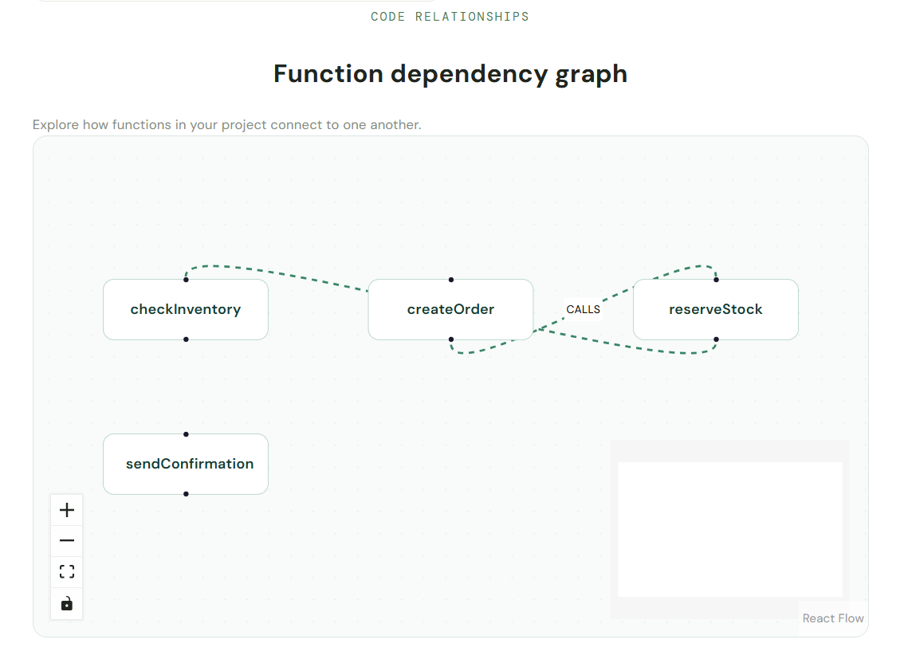

# TraceWise

**Graph-powered code impact analysis for JavaScript and TypeScript projects.**

TraceWise analyses function definitions and function calls, stores their relationships in FalkorDB, and visualises the resulting dependency graph. Developers can select a function and identify other functions that may be affected by changes to it.

## The Problem

Changing a function can have consequences throughout a codebase. Developers need to understand which other functions depend on the code they're modifying before making changes.

TraceWise uses graph-based analysis to make these relationships easier to explore.

## Features

- **Code analysis:** Parses JavaScript, JSX, TypeScript, and TSX files.
- **Function discovery:** Identifies supported function declarations and function expressions.
- **Dependency graph:** Stores function nodes and function-call relationships in FalkorDB.
- **Interactive visualisation:** Displays the discovered dependency graph in the browser.
- **Impact analysis:** Finds functions that transitively call a selected function, up to five relationship levels away.
- **Project upload:** Accepts ZIP archives of source code for analysis.
- **Upload safeguards:** Applies archive size, file count, and extraction limits to uploaded projects.

## Tech Stack

### Frontend

- React
- TypeScript
- Vite
- React Flow (`@xyflow/react`)
- CSS

### Backend

- Python
- FastAPI
- Tree-sitter Language Pack
- PyFalkorDB / FalkorDB Python client

### Graph Database

- FalkorDB
- Cypher graph queries

## Architecture

1. A developer uploads a ZIP archive containing source code.
2. The FastAPI backend extracts supported source files and analyses their syntax.
3. The analyser discovers functions and function calls.
4. The graph builder stores the discovered functions and relationships in FalkorDB.
5. The frontend retrieves the graph and displays it interactively.
6. A developer selects a function to explore its potential downstream impact.

## Graph Model

FalkorDB is the graph database at the centre of TraceWise's impact analysis. TraceWise represents discovered functions as nodes and function calls as directed relationships.

### Graph Visualisation

TraceWise visualises function dependencies as a directed graph stored in FalkorDB. Each node represents a discovered function, while each `CALLS` edge represents a function calling another function.

The graph helps developers explore code relationships and understand which functions may be affected by changes.



### Graph Structure

The following example illustrates how TraceWise models a function call:

```text
(:Function {name: "createOrder"})
              |
              | CALLS
              v
(:Function {name: "reserveStock"})
              |
              | CALLS
              v
(:Function {name: "checkInventory"})
```

- **Nodes:** Each discovered function is represented by a `Function` node.
- **Relationships:** A directed `CALLS` edge connects a caller to the function it calls.
- **Graph queries:** Impact analysis traverses incoming `CALLS` relationships to identify functions that directly or indirectly depend on a selected function.

### How FalkorDB Powers Impact Analysis

1. The backend parses supported source files and discovers functions and function calls.
2. The graph builder stores function nodes and `CALLS` relationships in FalkorDB.
3. When a developer selects a function, the backend queries FalkorDB for functions that call it, directly or indirectly, up to five relationship levels away.
4. TraceWise displays the resulting potential impact in the interface.

This means the impact analysis is based on relationships stored in the graph database, rather than simply displaying a static dependency diagram.

### Example Cypher Query

The following query illustrates the graph traversal used to find potential dependents of a selected function:

```
MATCH (changed:Function {name: $function_name})
OPTIONAL MATCH (dependent:Function)-[:CALLS*1..5]->(changed)
RETURN changed.name AS changed_function,
       collect(DISTINCT dependent.name) AS affected_functions
```

The incoming relationship traversal finds functions that call the selected function directly or through intermediate functions.

This example illustrates the graph query pattern; the application's actual query implementation is in `backend/graph_builder.py` and `backend/main.py`.

## Getting Started

### Prerequisites

Install the following:

- Python 3.14 or a compatible Python version
- Node.js and npm
- Docker
- Git

### 1. Clone the Repository

```
git clone https://github.com/YOUR_USERNAME/tracewise.git
cd tracewise
```

Replace `YOUR_USERNAME` with your GitHub username.

### 2. Start FalkorDB

Run the FalkorDB Docker image:

```
docker run -d \
  --name tracewise-db \
  -p 6379:6379 \
  -p 3000:3000 \
  falkordb/falkordb:latest
```

If the container already exists, start it with:

```
docker start tracewise-db
```

The application connects to FalkorDB on port `6379`. The browser interface is available on port `3000` when provided by the image configuration.

### 3. Set Up the Backend

Open a terminal at the repository root:

```
cd backend
python3 -m venv .venv
source .venv/bin/activate
pip install -r requirements.txt
uvicorn main:app --reload
```

The API runs at:

`http://localhost:8000`

FastAPI's interactive API documentation is available at:

`http://localhost:8000/docs`

Keep this terminal running.

### 4. Set Up the Frontend

Open a second terminal at the repository root:

```
cd frontend
npm install
npm run dev
```

Open the local URL printed by Vite, normally:

`http://localhost:5173`

Keep the backend, frontend, and FalkorDB running while using the application.

## Testing

Backend tests are located in the `backend/` directory.

Activate the backend virtual environment and run:

```
cd backend
source .venv/bin/activate
python -m unittest discover -s . -p 'test_*.py'
```

The frontend can be checked with:

```
cd frontend
npm run build
npm run lint
```

## Current Limitations

TraceWise is an early-stage prototype.

- Function discovery and call resolution are based on supported syntax and function names.
- Functions with identical names in different files may be conflated.
- Import relationships and full module resolution are not modelled explicitly.
- The analyser does not yet provide complete semantic understanding of a codebase.
- Test discovery and test-impact reporting are not implemented.
- Impact analysis reports potential dependencies, not a guarantee that every listed function will be affected by a particular change.

These limitations are important when interpreting the results.

## Future Improvements

Potential improvements include:

- Scope-aware function identification.
- Import and module relationship modelling.
- More accurate call resolution.
- Test discovery and test-impact analysis.
- Support for additional programming languages.
- More comprehensive automated testing.

## Project Status

TraceWise is a prototype exploring how graph databases can help developers understand code dependencies and assess the potential impact of changes.
